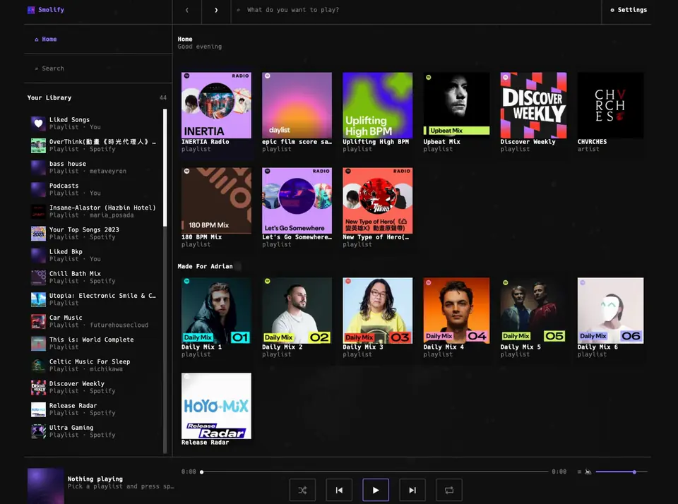

# Smolify

A small, fast Spotify client for the terminal and the desktop, built with
[Flatte](https://github.com/lunguini/flatte) and
[go-librespot](https://github.com/devgianlu/go-librespot).

Work in progress. Requires Spotify Premium. Not affiliated with Spotify.

<p align="center">
  
</p>

## Install

macOS and Linux, with [Homebrew](https://brew.sh):

```bash
brew install --cask lunguini/tap/smolify
smolify          # in the terminal
smolify -gui     # in a window (macOS)
```

`brew upgrade --cask smolify` updates it.

Or download a build for macOS, Linux or Windows from the
[releases](https://github.com/lunguini/smolify/releases/latest). The audio
codecs are built in; Linux builds need glibc 2.39 or later (Ubuntu 24.04 and
newer), with libmpg123 and ALSA installed. The window (`-gui`) is macOS only.

With Go 1.26 or later, from source:

```bash
brew install libogg libvorbis flac mpg123   # audio codecs (cgo)
go install github.com/lunguini/smolify/cmd/smolify@latest
```

`go install` puts `smolify` in `$(go env GOPATH)/bin` (usually `~/go/bin`);
add that to your `PATH` if the command is not found.

On first run, Smolify shows a code: open spotify.com/pair and enter it to
sign in.

## Audio output

The Settings page's Audio output choice defaults to Auto: AudioToolbox on
macOS, WASAPI on Windows, and PulseAudio on Linux (which also works with
PipeWire's PulseAudio server). Set `SMOLIFY_AUDIO_BACKEND` to a backend
offered for the current OS to override the saved choice, for example
`SMOLIFY_AUDIO_BACKEND=alsa` on Linux.

To build Smolify for Linux and verify a silent output stream against a
headless PulseAudio null sink, with no Spotify account, run:

```bash
./scripts/test-linux-audio.sh
```

The script uses Docker to build the app and run the headless check.

## Themes

Smolify draws in its own look by default. If you use
[Spicetify](https://spicetify.app), the color schemes of your installed
Spicetify themes show up under Settings › Appearance › Theme, and switching
restyles Smolify right away, in the terminal and in the window. Smolify reads
each theme's `color.ini` from Spicetify's config folder (`SPICETIFY_CONFIG`
overrides where it looks). It ignores `user.css`, which styles Spotify's own
interface.

## Build

```bash
brew install libogg libvorbis flac mpg123   # audio codecs (cgo)
go run ./cmd/smolify                        # in the terminal
go run ./cmd/smolify -gui                   # in a window (macOS)
go run ./cmd/smolify -sign-out              # forget the Spotify sign-in
go run ./cmd/smolify -debug-log smolify.log # log player events and memory
```

## License

GPL-3.0 — see [LICENSE](LICENSE).

The bundled Inter font (`internal/app/fonts`) is under the SIL Open Font
License 1.1 — see [its license](internal/app/fonts/OFL.txt).
